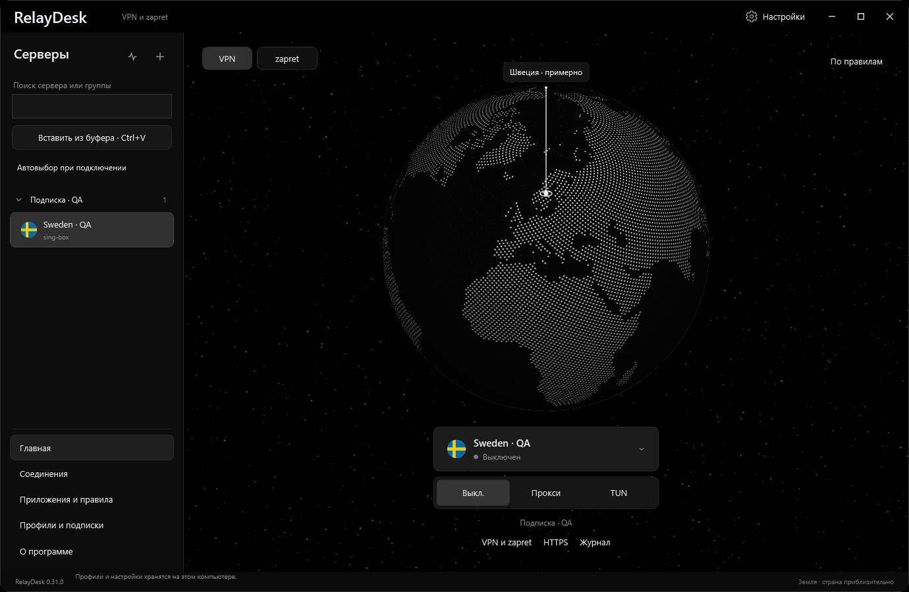
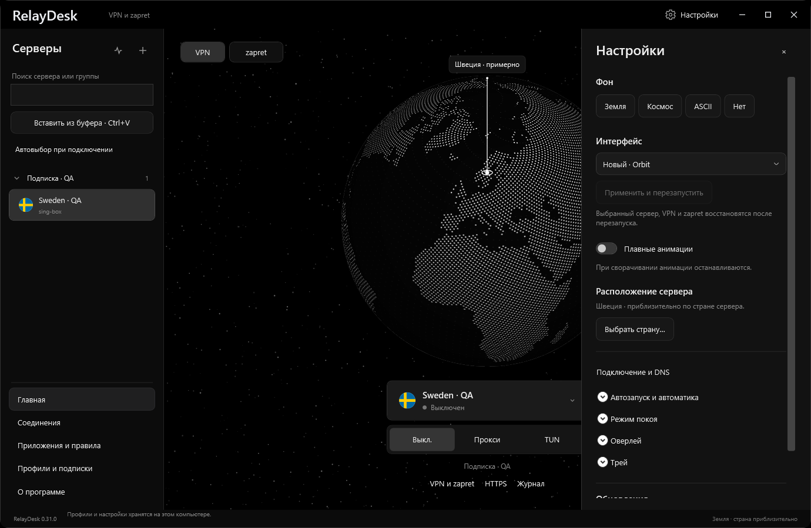
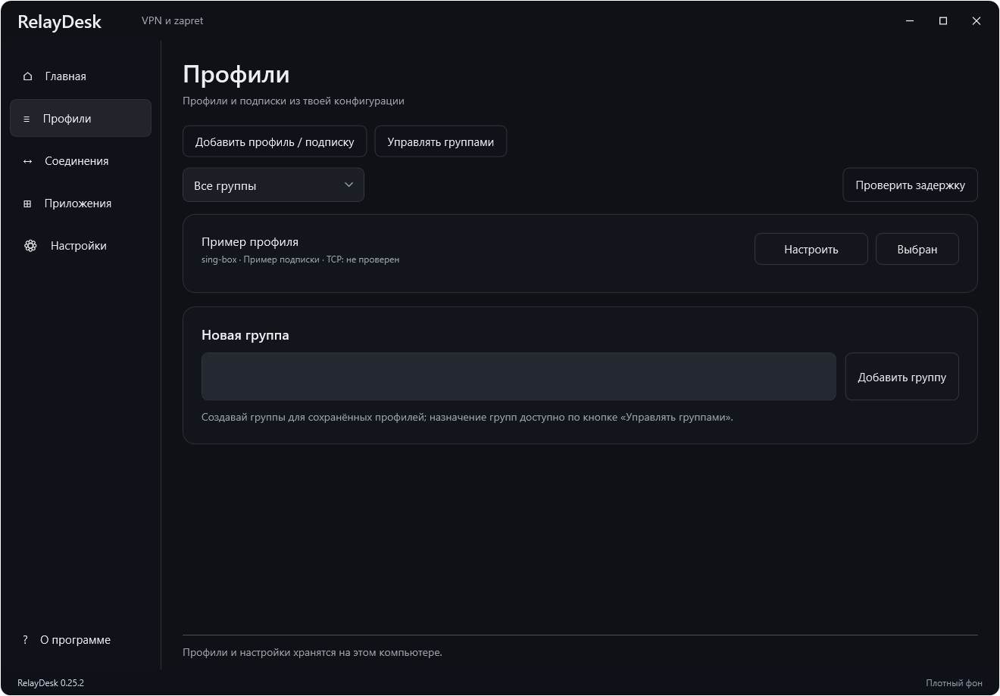
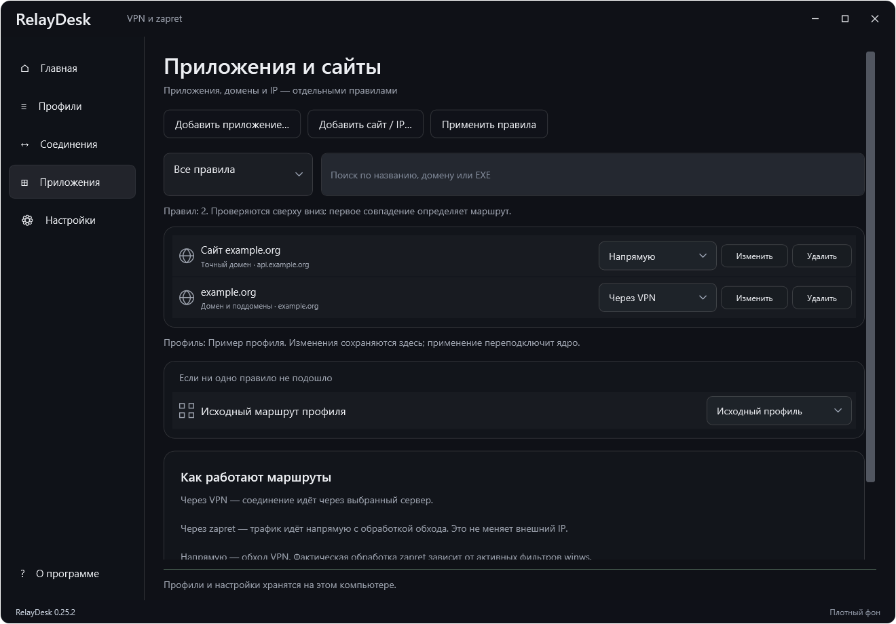
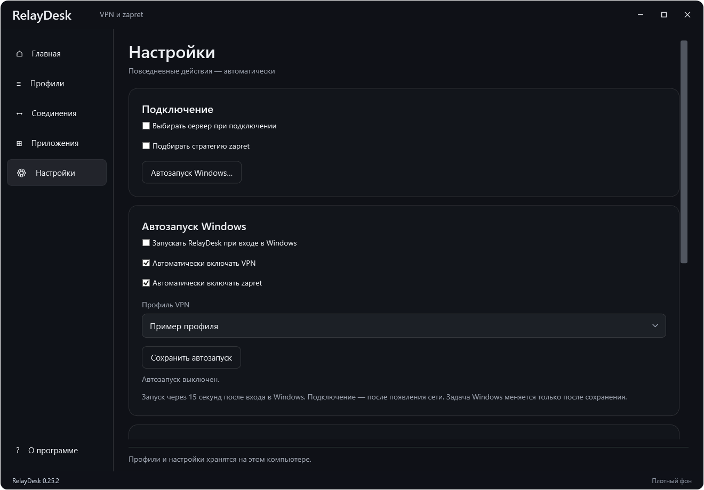

# RelayDesk

Приложение для Windows: sing-box, Xray, mihomo и zapret, импорт VPN-профилей и настройка маршрутов по приложениям и адресам.



С версии 0.31 доступен интерфейс Orbit. В настройках можно выбрать «Новый · Orbit» или «Классический» и нажать «Применить и перезапустить». Выбранный сервер, VPN и zapret восстанавливаются после перезапуска. Профили и правила общие для обоих интерфейсов.

Снимки Orbit сделаны с тестовой подпиской и выключенными ядрами. Личные ключи и подписки на снимках отсутствуют. Снимки остальных разделов ниже показывают классический интерфейс.

<details><summary>Настройки Orbit и выбор интерфейса</summary>



</details>

<details>
<summary>Профили и группы подписок</summary>



</details>

<details>
<summary>Правила приложений и сайтов</summary>



</details>

<details>
<summary>Автозапуск Windows</summary>



</details>

## Установка

Скачай `RelayDesk-Setup-<версия>-x64.exe` из [Releases](https://github.com/bernicetownsend1955/RelayDesk-VPN/releases/latest). Установщик включает ядра; скачивать их отдельно не нужно. Настройки и профили сохраняются в `%LOCALAPPDATA%\RelayDesk`.

Поддерживаются ссылки VLESS, VMess, Trojan, Shadowsocks, конфигурации JSON/YAML, HTTPS-подписки и ссылки `happ://add/`. Перед импортом показывается предпросмотр. Профили можно объединять в группы; задержка серверов проверяется во вкладке «Профили».

## Голос Discord

Прямое подключение через zapret может зависать на DTLS у части голосовых узлов. Переключатель обработки голосового UDP предназначен для диагностики и не гарантирует устранения этой проблемы. В проверенном сценарии Discord работает через VPN, в том числе одновременно с zapret для другого трафика. Не включай автоматическое направление Discord напрямую, если используешь этот вариант.

## Интерфейс и данные

В Orbit VPN управляется кнопками «Выкл. / Прокси / TUN», zapret включается отдельно. Зелёный индикатор означает запущенное ядро; доступ к сети проверяется кнопкой HTTPS. Страна на Земле приблизительная, её можно указать вручную. Фон выбирается в настройках: Земля, космос, ASCII-акулы или чёрный.

Подписку можно вставить через Ctrl+V в любом разделе Orbit: после загрузки откроется список серверов для выбора и поле группы. В текстовых полях Ctrl+V вставляет текст. В классическом интерфейсе прежние команды вставки сохраняются.


В «Соединениях» щелчок по заголовку сортирует строки, правая кнопка открывает фильтр столбца. Постоянных полей под заголовками нет. Ctrl + щелчок выделяет несколько соединений, Ctrl+A — все видимые соединения с учётом фильтров. В текстовом поле Ctrl+A выделяет текст. После выделения появляется кнопка «Настроить выбранные…». Она позволяет сохранить правила VPN, zapret или прямого подключения с общим предпросмотром. Одинаковые цели объединяются; для применения правил к работающему профилю нужно переподключение.

С версии 0.28 на главной доступны пресеты «По правилам», «Всё напрямую» и «Всё через VPN» для sing-box и Xray. Смена пресета переподключает работающий VPN; при выключенном VPN выбор сохраняется до подключения. Отдельные правила остаются в настройках и возвращаются с пресетом «По правилам». zapret включается отдельно.

В разделе «Приложения» для остальных подключений можно выбрать исходный маршрут профиля, VPN, напрямую или zapret. Это общий выбор для всех профилей и групп. Он действует, если ни одно правило не подошло, и временно перекрывается пресетами. При выключенном zapret его маршрут возвращается к исходному профилю. Для применения к работающему VPN нажми «Применить правила».

С версии 0.26 правила приложений, доменов и IP общие для всех VPN и групп. При переносе приоритет имеют правила из «Мой VPN»; перед переносом сохраняется резервная копия. Правила можно менять из любого профиля. Кнопка «Применить правила» переподключает работающий VPN, остальные серверы используют изменения при следующем подключении. В sing-box правила EXE автоматически включают TUN в конфигурации запуска. Xray применяет общие правила адресов; для EXE требуется sing-box.

С версии 0.27.1 TUN, системный прокси и локальный порт тоже общие. При переносе они берутся из «Мой VPN». Изменение режима в настройках или параметрах другого профиля действует на все VPN и группы. Серверы, ключи и собственные DNS сохраняются в профилях. Общий TUN используется в sing-box; Xray использует общий системный прокси.

В версии 0.25 добавлены графитовая панель с ASCII-акулами, анимированное название, режим покоя, трей и редактор правил с проверкой пересечений. Данные соединений берутся из ядра; тестовые строки превью в релиз не включены. Прежние настройки JSON/YAML, TUN, DNS, подписок и ядер доступны в расширенном разделе.

С версии 0.29 в настройках можно включить оверлей VPN. Он показывает название подключения, входящую и исходящую скорость в Мбит/с поверх других окон, в том числе при свёрнутой главной панели. Оверлей можно перетаскивать, размещать в любом углу, менять непрозрачность и размер текста; параметры сохраняются. Правая кнопка открывает меню настройки и скрытия. Режим покоя включается тумблером.

С версии 0.29.1 время до затухания задаётся ползунком от 5 до 300 секунд. Оверлей показывает текст без рамки и заливки. Для него можно отдельно включить прозрачный ASCII-фон с акулой, выбрать яркость символов и остановить движение.

С версии 0.30 на оверлей можно перетаскивать EXE, ярлык приложения или ссылку сайта. Затем открывается редактор общего правила с выбором VPN, zapret или прямого подключения. Ярлык и приложение при этом не запускаются. Для HTTPS-ссылки можно выбрать импорт подписки. Работающий VPN переподключается по кнопке «Применить правила».

В «Профилях» кнопка «Считать QR-код» читает изображение, буфер обмена или выделенную область экрана. Чтение с экрана доступно и по правой кнопке на оверлее. «Поделиться QR» создаёт код для ссылки подписки, профиля VPN или общих правил и режима подключения. Ссылки подписок передаются обычным QR-кодом, пакеты настроек предназначены для RelayDesk. Большие пакеты разбиваются на несколько изображений; получатель должен считать все части и подтвердить предпросмотр. Перед сохранением пакета создаётся резервная копия. QR обрабатываются локально с помощью [ZXing.Net](https://github.com/micjahn/ZXing.Net); [лицензия](RelayDesk/Assets/ZXing.Net.LICENSE.txt) включена в установщик.

Оверлей запускается отдельным процессом с обычными правами Windows для приёма перетаскивания из Проводника и браузера. Основная программа управляет ядрами с правами администратора. Оверлей получает оформление и скорость через локальный канал; сохранение правил и импорт выполняет основная программа после предпросмотра.

Оверлей учитывает только соединения через VPN RelayDesk. sing-box и mihomo используют счётчики активных соединений, поэтому короткие соединения между замерами могут быть пропущены. Xray использует накопительные счётчики VPN-выходов. Трафик напрямую и zapret не прибавляется. Если источник недоступен, вместо скорости отображается прочерк.

Установщик закрывает RelayDesk перед обновлением и запускает его после установки. Восстанавливаются прежний сервер, состояние VPN и zapret, вкладка и черновики несохранённых полей. Встроенное обновление использует тот же механизм. Снимок перезапуска одноразовый: обычный запуск программы не повторяет восстановление.

Обновление сохраняет собственные профили и настройки пользователя в прежней папке `%LOCALAPPDATA%\RelayDesk`. Перед первым сохранением новой версии создаётся резервная копия исходных файлов. Новые пользователи получают чистую конфигурацию: личные VPN-профили и ключи разработчика не включаются в установщик. Тестовые правила из отдельного дизайн-превью автоматически не заменяют рабочие правила.

## Сборка

Для сборки исходников нужен .NET 9 SDK:

```powershell
dotnet build .\RelayDesk\RelayDesk.csproj -c Release
```

Сборка установщика описана в [инструкции](RelayDesk/installer/README.md). Исходники находятся в папке [RelayDesk](RelayDesk).

Проверки интерфейса запускаются в Windows с отдельными тестовыми данными:

```powershell
dotnet run --project .\RelayDesk.ModernChecks -c Release
dotnet run --project .\RelayDesk.UIchecks -c Release
```

Они проверяют навигацию, диалоги, сохранение правил и автозапуска, обработку ошибок без установленных ядер и сохранность профиля. Проверка доступности реального VPN-сервера требует отдельного подключения.

## Выпуск обновлений

RelayDesk проверяет обновления при запуске и раз в 6 часов. Пакеты автоматически загружаются и проверяются по SHA-256. Ядра применяются при следующем запуске, обновление приложения — при закрытии или следующем запуске. Работающее соединение сохраняется во время загрузки. Windows может запросить права администратора при установке.

Источники закреплены: bernicetownsend1955/RelayDesk-VPN, SagerNet/sing-box, Flowseal/zapret-discord-youtube, XTLS/Xray-core и MetaCubeX/mihomo. Изменить их в настройках нельзя.

Измени версию в `RelayDesk/RelayDesk.csproj`, добавь `RelayDesk/installer/release-notes-<версия>.md`, загрузи изменения и тег `v<версия>`. Workflow [Release Windows installer](.github/workflows/release.yml) соберёт установщик с ядрами и опубликует EXE и SHA-256. Тег должен совпадать с версией проекта. Опубликованные версии не перезаписываются.

Личные профили, пароли, адреса подписок и диагностические захваты в репозиторий не включены.
