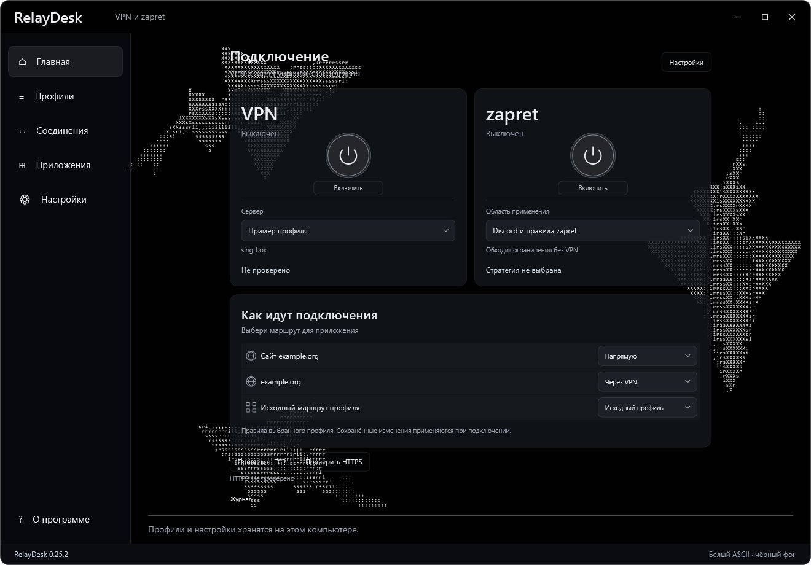
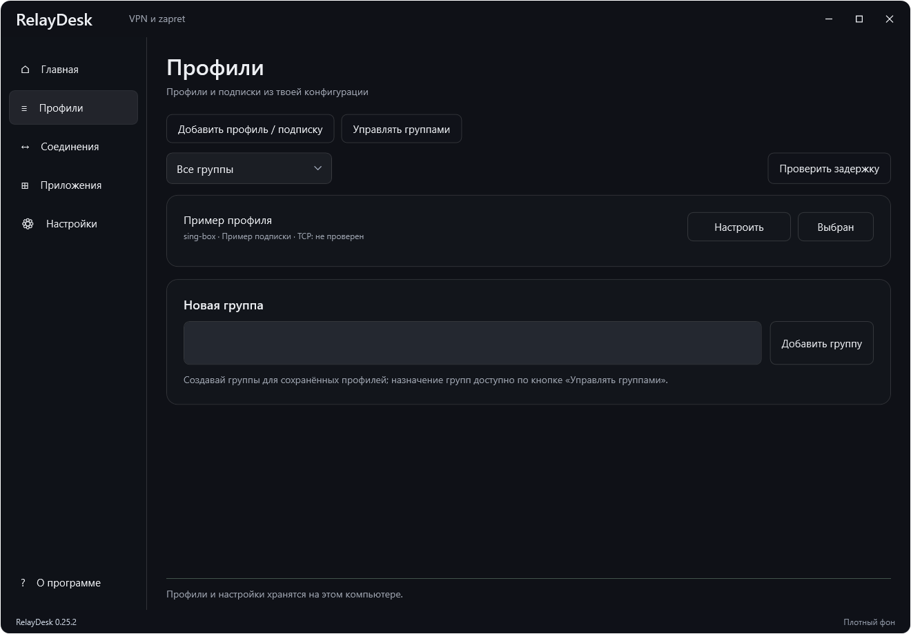
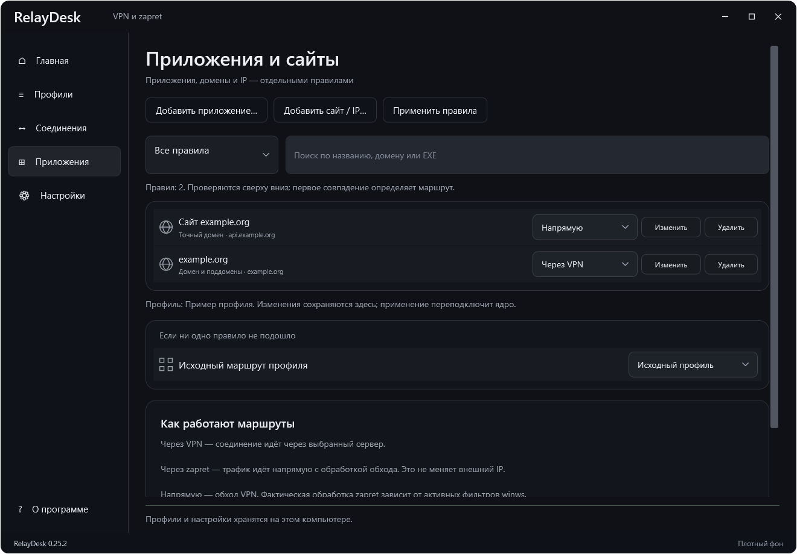
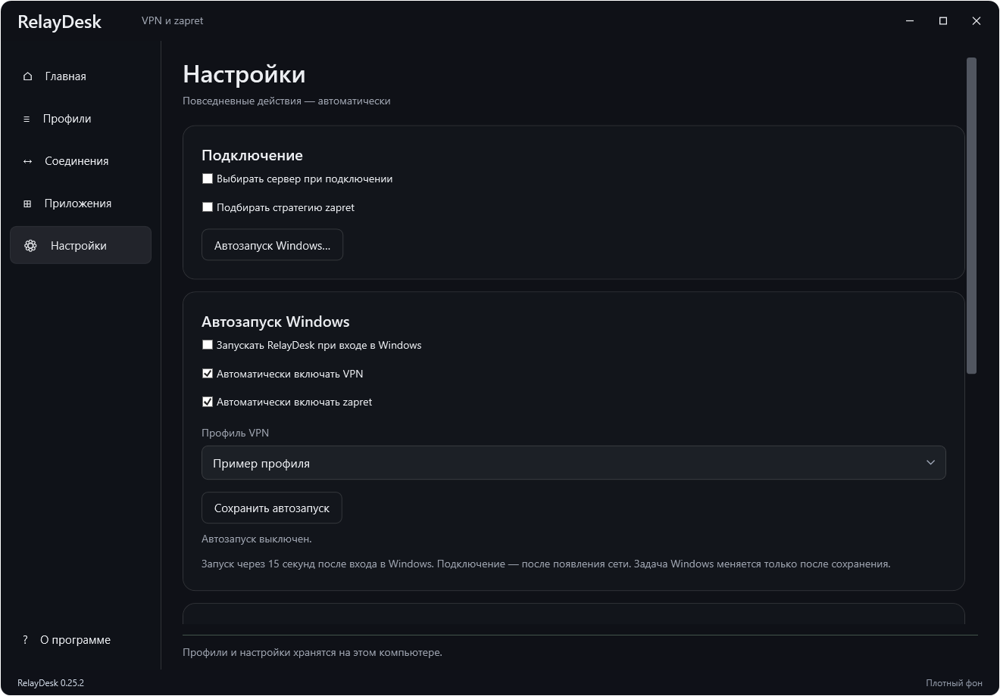

# RelayDesk

Приложение для Windows: sing-box, Xray, mihomo и zapret, импорт VPN-профилей и настройка маршрутов по приложениям и адресам.



Снимки версии 0.25.2 с тестовым профилем. Ядра выключены; личные подписки и ключи на снимках отсутствуют. На снимках ниже выбран плотный фон без ASCII-анимации.

<details>
<summary>Профили и группы подписок</summary>



</details>

<details>
<summary>Правила приложений и сайтов</summary>



</details>

<details>
<summary>Автозапуск Windows</summary>



</details>

## Установка

Скачай `RelayDesk-Setup-<версия>-x64.exe` из [Releases](https://github.com/bernicetownsend1955/RelayDesk-VPN/releases/latest). Установщик включает ядра; скачивать их отдельно не нужно. Настройки и профили сохраняются в `%LOCALAPPDATA%\RelayDesk`.

Поддерживаются ссылки VLESS, VMess, Trojan, Shadowsocks, конфигурации JSON/YAML, HTTPS-подписки и ссылки `happ://add/`. Перед импортом показывается предпросмотр. Профили можно объединять в группы; задержка серверов проверяется во вкладке «Профили».

## Голос Discord

Прямое подключение через zapret может зависать на DTLS у части голосовых узлов. Переключатель обработки голосового UDP предназначен для диагностики и не гарантирует устранения этой проблемы. В проверенном сценарии Discord работает через VPN, в том числе одновременно с zapret для другого трафика. Не включай автоматическое направление Discord напрямую, если используешь этот вариант.

## Интерфейс и данные

В версии 0.25 добавлены графитовая панель с ASCII-акулами, анимированное название, режим покоя, трей и редактор правил с проверкой пересечений. Данные соединений берутся из ядра; тестовые строки превью в релиз не включены. Прежние настройки JSON/YAML, TUN, DNS, подписок и ядер доступны в расширенном разделе.

Обновление сохраняет собственные профили и настройки пользователя в прежней папке `%LOCALAPPDATA%\RelayDesk`. Перед первым сохранением новой версии создаётся резервная копия исходных файлов. Новые пользователи получают чистую конфигурацию: личные VPN-профили и ключи разработчика не включаются в установщик. Тестовые правила из отдельного дизайн-превью автоматически не заменяют рабочие правила.

## Сборка

Для сборки исходников нужен .NET 9 SDK:

```powershell
dotnet build .\RelayDesk\RelayDesk.csproj -c Release
```

Сборка установщика описана в [инструкции](RelayDesk/installer/README.md). Исходники находятся в папке [RelayDesk](RelayDesk).

Проверки интерфейса запускаются в Windows с отдельными тестовыми данными:

```powershell
dotnet run --project .\RelayDesk.ModernChecks -c Release
dotnet run --project .\RelayDesk.UIchecks -c Release
```

Они проверяют навигацию, диалоги, сохранение правил и автозапуска, обработку ошибок без установленных ядер и сохранность профиля. Проверка доступности реального VPN-сервера требует отдельного подключения.

## Выпуск обновлений

RelayDesk проверяет обновления при запуске и раз в 6 часов. Пакеты автоматически загружаются и проверяются по SHA-256. Ядра применяются при следующем запуске, обновление приложения — при закрытии или следующем запуске. Работающее соединение сохраняется во время загрузки. Windows может запросить права администратора при установке.

Источники закреплены: bernicetownsend1955/RelayDesk-VPN, SagerNet/sing-box, Flowseal/zapret-discord-youtube, XTLS/Xray-core и MetaCubeX/mihomo. Изменить их в настройках нельзя.

Измени версию в `RelayDesk/RelayDesk.csproj`, добавь `RelayDesk/installer/release-notes-<версия>.md`, загрузи изменения и тег `v<версия>`. Workflow [Release Windows installer](.github/workflows/release.yml) соберёт установщик с ядрами и опубликует EXE и SHA-256. Тег должен совпадать с версией проекта. Опубликованные версии не перезаписываются.

Личные профили, пароли, адреса подписок и диагностические захваты в репозиторий не включены.
